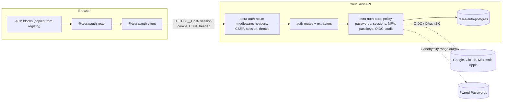

# Tesra blueprint

> Phase 0 done, 2026-09-13. Next: Phase 1.
> Evidence: [research/2026-09-baseline.md](research/2026-09-baseline.md) and [research/2026-09-providers-and-tooling.md](research/2026-09-providers-and-tooling.md).

## 1. What Tesra is

Two products with one quality bar:

1. **Auth kit.** Rust authentication (axum) with a TypeScript client, React hooks and UI blocks. Every control maps to an OWASP ASVS 5.0 requirement and ships with a test that proves it.
2. **UI kit.** React components on Base UI primitives, styled with Tailwind CSS and design tokens, distributed as a shadcn-compatible registry.

## 2. Principles

1. **Verified, not claimed.** A control counts as done only when a named test proves it and the ASVS matrix points to that test. CI fails when an in-scope requirement has no passing test.
2. **Never invent crypto.** Use audited or widely reviewed crates for hashing, WebAuthn, OIDC and randomness. Own the flows, policies, storage and UI.
3. **Security fixes must reach every project.** Anything security-relevant ships as a versioned package. Presentation ships as copy-in source.
4. **Accessible by default.** WCAG 2.2 AA, with WAI-ARIA APG keyboard behavior tested for every component.
5. **Pick a level, get a configuration.** ASVS L1/L2/L3 are code presets, not just documentation.
6. **Follow the stricter source.** When ASVS, NIST and the OWASP cheat sheets disagree, use the stricter rule and document any deviation.

## 3. Decision log

| ID | Decision | Why |
|---|---|---|
| D-01 | Name: **Tesra**. npm scope `@tesra`, crates `tesra-*`, PyPI `tesra`, GitHub org `tesra-dev`, domain `tesra.dev` | All free on 2026-09-13, except that the GitHub user `tesra` is dormant, so the org takes a suffix. The name comes from *tessera*: a mosaic tile, and the tablet carrying a Roman watchword |
| D-02 | Public repository. Code under MIT OR Apache-2.0; ASVS-derived files under CC BY-SA 4.0 | Rust ecosystem norm; Apache-2.0 adds a patent grant; the ASVS license requires share-alike for derived text |
| D-03 | Default assurance profile: **ASVS L2** | ASVS 5.0: "Most applications should be striving to achieve this level of security." L1 is one line of config away for prototypes and low-risk apps |
| D-04 | Social login order: Google, GitHub, Microsoft, Apple | Product priority. The same order applies to implementation, docs and sign-in buttons |
| D-05 | TypeScript 7 for type checking, Biome for linting | TS 7 is the fast native compiler; typescript-eslint doesn't support TS 7 yet |
| D-06 | Supply-chain hardening from the first commit (§8.2) | OWASP Top 10:2025 A03 Software Supply Chain Failures |

## 4. Repository layout

```
tesra/
├── crates/                    # Cargo workspace
│   ├── auth-core/             # tesra-auth-core: policy, passwords, sessions, MFA, passkeys, OIDC, audit. No HTTP.
│   ├── auth-axum/             # tesra-auth-axum: routes, extractors, middleware (session, CSRF, headers, throttle), OpenAPI
│   ├── auth-postgres/         # tesra-auth-postgres: sqlx store + migrations
│   └── auth-testkit/          # tesra-auth-testkit: ASVS conformance suite for stores and deployments
├── packages/                  # pnpm workspace
│   ├── auth-client/           # @tesra/auth-client: typed API client + WebAuthn helpers, framework-agnostic
│   ├── auth-react/            # @tesra/auth-react: provider and hooks
│   └── tokens/                # @tesra/tokens: DTCG tokens → CSS variables for Tailwind
├── registry/                  # shadcn registry source, published as @tesra/…
├── apps/
│   ├── docs/                  # docs site; hosts the built registry and the ASVS status page
│   ├── playground-api/        # reference Rust server using every crate
│   └── playground-web/        # reference React app; target for E2E tests and ZAP scans
├── scripts/asvs_gate.py       # ASVS traceability gate (+ tests in scripts/tests)
├── security/asvs-matrix.csv   # requirement → scope → status → implementation → tests
├── standards/                 # upstream standards data (separate license)
└── docs/
```

## 5. Distribution (hybrid)

| What | Channel | Why |
|---|---|---|
| Rust auth crates | crates.io, released with release-plz | A security fix reaches every project with a version bump |
| `@tesra/auth-client`, `@tesra/auth-react` | npm, versioned with changesets | Client-side security behavior (sign-out cleanup, WebAuthn handling) must stay patchable |
| `@tesra/tokens` | npm | One theme source for every project |
| UI primitives and auth blocks | shadcn registry, `shadcn add @tesra/sign-in` | Customize per project. Blocks import the versioned auth packages, so their logic stays patchable |

Releases publish only from CI, using trusted publishing (OIDC) on crates.io and npm; npm adds provenance attestations automatically. Crates stay `publish = false` and packages stay `"private": true` until their first release.

## 6. Auth kit

### 6.1 How the pieces connect



### 6.2 Decisions

**A-01 Browser sessions use opaque reference tokens, not JWTs.**
- A 256-bit token from the OS CSPRNG; ASVS V7.2.3 requires at least 128 bits. The database stores only its SHA-256, so a leaked table contains no usable sessions.
- The cookie is `__Host-tesra-session; Secure; HttpOnly; SameSite=Lax; Path=/` (V3.3.1–V3.3.4). Lax keeps users signed in when they follow a link from email; A-06 handles CSRF. The L3 profile switches to Strict.
- Revoking a session is a row delete (V7.4.1). Easy revocation is the reason not to use JWTs here.
- Every sign-in, re-authentication and privilege change issues a new token and deletes the old one (V7.2.4).
- The session row records the assurance level reached, methods used, auth time, idle and absolute expiry, and a device label for the session list.
- To keep reads cheap, the idle timer is written at most once a minute per session.

**A-02 Timeouts come from the active profile** (§6.3), following NIST SP 800-63B-4 and ASVS V7.3. Deviations must be documented (V7.1.1).

**A-03 Passwords.**
- Argon2id with m=19456 KiB, t=2, p=1 via RustCrypto `argon2`, stored as PHC strings. On a successful sign-in, a hash with outdated parameters is rehashed. An optional pepper is passed as Argon2's secret parameter and comes from the secret provider (A-15).
- Minimum length is 15 when the password can be the only factor, and 8 when the profile makes MFA mandatory (NIST 800-63B-4, V6.2.1). At least 64 characters must be accepted (V6.2.9); the cap is 256.
- No composition rules (V6.2.5), no forced rotation (V6.2.10), no hints or security questions (V6.4.2). Paste and password managers work (V6.2.7).
- Passwords are compared exactly as entered (V6.2.8), except for Unicode NFC normalization, which NIST recommends. NFC changes neither length nor case; we record this as a documented interpretation.
- Blocklist layers: a bundled common-password list filtered by the policy (V6.2.4 requires at least the top 3,000), app-supplied context words (V6.1.2, V6.2.11), and Pwned Passwords k-anonymity lookups with `Add-Padding` (V6.2.12). If Pwned Passwords is unreachable, the kit accepts after the local checks and emits an audit event. The L3 profile rejects instead.

**A-04 No account enumeration** (V6.3.8).
- Signing in as an unknown user verifies against a dummy Argon2id hash with the same parameters, so the work and the response are identical.
- Sign-up and password reset always reply "check your email". The email itself tells the recipient whether an account exists. Emails go out through a queue, so response time doesn't reveal anything.
- Every failure returns the same HTTP status and body shape.

**A-05 Throttle rather than lock out** (V6.1.1, V6.3.1, V2.4.1).
- GCRA rate limits (`governor`) keyed by account, by IP prefix, and by account + IP.
- Exponential backoff per account, plus a pluggable challenge hook (CAPTCHA or proof-of-work) past a threshold.
- After 100 consecutive failures, password sign-in is disabled for that account until the user resets it (the NIST limit). Passkey sign-in stays available, so an attacker can't lock out a user who has one.

**A-06 CSRF in layers** (V3.5.1–V3.5.3, OWASP CSRF Cheat Sheet).
1. Signed double-submit token: an HMAC-SHA256 value bound to the session, set in a script-readable `__Host-tesra-csrf` cookie and sent back in an `X-CSRF-Token` header. The custom header also forces a CORS preflight for cross-origin callers.
2. Reject state-changing requests whose `Sec-Fetch-Site` is `cross-site`. The one exception is the Apple callback (A-10).
3. Check `Origin` against an allowlist when present.
4. Mutations only via POST, PUT, PATCH or DELETE, and JSON endpoints require `Content-Type: application/json`.

**A-07 Security headers on by default.** HSTS for one year with includeSubDomains (V3.4.1). A CSP baseline of `object-src 'none'; base-uri 'none'; frame-ancestors 'none'` (V3.4.3, V3.4.6). `X-Content-Type-Options: nosniff` (V3.4.4). `Referrer-Policy: strict-origin-when-cross-origin`, with `no-referrer` on reset pages (V3.4.5). `Cross-Origin-Opener-Policy: same-origin` (V3.4.8). `Cache-Control: no-store` on auth responses (V14.3.2). `Clear-Site-Data` on sign-out (V14.3.1). CORS uses an allowlist only (V3.4.2).

**A-08 MFA and passkeys.**
- **Passkeys are first-class,** via the `webauthn-rs` safe API, which has passed a SUSE security audit. Persisting ceremony state requires the `danger-allow-state-serialisation` feature, so the state lives only on the server, is single-use, expires after 5 minutes and is never put in a cookie. Conditional UI uses the crate's `conditional-ui` feature. Each credential stores its ID, public key, AAGUID (to show provider names), backup flags, and created and last-used times.
- **TOTP** (`totp-rs`) uses SHA-1, 6 digits and a 30-second step (V6.5.5). SHA-1 is what authenticator apps support, and HMAC-SHA-1 is still approved; revisit before NIST retires SHA-1. Each time step is accepted once per user (V6.5.1), and only server time counts (V6.5.8). Seeds are 160 bits from the CSPRNG (V6.5.3), encrypted at rest. L1 and L2 also accept the previous step to allow for clock drift; L3 accepts only the current step. A strict mode, where a code dies 30 seconds after it's issued, is a config switch.
- **Recovery codes:** 10 single-use codes of 120 bits each (24 Crockford base32 characters, shown in groups). At 112 bits or more, V6.5.2 allows a plain SHA-256 lookup, so checking a code is a constant-time lookup instead of ten Argon2 runs.
- **Email codes and links** expire within 10 minutes (V6.5.5), are bound to the request that created them (V6.6.2) and are rate limited (V6.6.3). They are not a valid factor at L3 (V6.3.6).
- **No SMS** (NIST lists it as restricted; V6.6.1 forbids it at L3). No push MFA.

**A-09 Recovery and credential changes.**
- Reset tokens are 256 bits, stored hashed, single use and valid for 15 minutes. The reset URL is built from the configured base URL, never from the Host header. A reset doesn't sign the user in and doesn't bypass MFA (V6.4.3). By default it ends all other sessions (V7.4.3) and notifies the user (V6.3.7).
- Changing the password, email, phone or MFA settings requires fresh re-authentication (V7.5.1, V6.2.3). The `RecentAuth(Duration)` extractor enforces this.
- A lost MFA factor is recovered with a recovery code or an identity check as strong as enrollment (V6.4.4). Admins can start a reset but can never set a user's password (V6.4.6).

**A-10 Social login: Google, GitHub, Microsoft, Apple, in that order.**

Rules for every provider:
- Authorization code flow with PKCE S256 and `state`, plus `nonce` for OpenID Connect providers. Everything is bound to a server-side pre-auth transaction that is single-use and expires after 10 minutes (V10.1.2, V10.2.1, V10.5.1).
- One callback URL per provider (`/auth/callback/google`, `/auth/callback/github`, …), and the transaction records which provider it expects. This defeats mix-up attacks even for GitHub, which sends no issuer (V10.2.2).
- Identities are keyed by provider + stable subject (V6.8.1, V10.5.2). Accounts are **never** linked by matching email; a user links a provider while signed in, after re-authenticating.
- Provider tokens stay on the server (V10.1.1).
- `amr`, `acr` and `auth_time` are honored when present. Otherwise a social sign-in counts as one factor (V6.8.4), so under L2 a passkey or TOTP step follows.

| Provider | Protocol | Issuer check | User key | Email |
|---|---|---|---|---|
| Google | OpenID Connect | Exactly `https://accounts.google.com` or `accounts.google.com` (Google documents both) | `sub` | Trusted only when `email_verified`; `hd` can restrict sign-in to a Workspace domain |
| GitHub | OAuth 2.0 only, no ID token (V10.5 doesn't apply; V10.2 does) | None; the per-provider callback does the job | Numeric `id` from `GET /user`, since `login` can change | Verified addresses from `GET /user/emails` |
| Microsoft | OpenID Connect v2.0 | Multi-tenant metadata publishes a templated issuer, so substitute the token's `tid`, then require an exact match. Optional tenant allowlist | `sub`, or `tid` + `oid` | Display and prefill only: Microsoft says `email` isn't guaranteed correct and can change |
| Apple | OpenID Connect with Apple rules | Exactly `https://appleid.apple.com` | `sub` | May be a private relay address. The name arrives once, in the `user` field of the first authorization; store it then |

Apple details:
- Requesting name or email forces `response_mode=form_post`, so the callback is a cross-site POST that doesn't carry `SameSite=Lax` or `Strict` cookies. Apple's transaction cookie is therefore `__Host-tesra-oauth; Secure; HttpOnly; SameSite=None`, lives 10 minutes and is single-use, as a documented exception under V3.3.2. The callback skips the CSRF token check (state, nonce and PKCE protect it), stores the result and 303-redirects to a same-site URL that issues the session.
- Apple accepts an ES256-signed client-secret JWT for at most 6 months. Tesra signs a fresh short-lived one for each token request with the private key from the secret provider, so there's no expiry date to forget.

**A-11 Service tokens (V9) are for machine-to-machine calls only.** JWTs with one allowlisted algorithm per key (EdDSA or ES256); `none` is always rejected. Keys come only from configured sources; `jku`, `x5u` and `jwk` headers are ignored. `exp`, `nbf`, `aud`, `iss` and `typ` are always checked.

**A-12 Audit events (V16.3).** A typed `AuthEvent` enum covers every sign-in attempt, factor change, session revocation, throttle hit and recovery step. Events go through `tracing` and a pluggable sink. Session IDs are logged only as an HMAC. Passwords, codes and tokens are never logged.

**A-13 Storage sits behind traits.** `tesra-auth-core` defines the store traits and `tesra-auth-postgres` implements them with `sqlx`. `tesra-auth-testkit` holds the conformance tests every store implementation must pass.

**A-14 Time and randomness are injected** through `Clock` and `Rng` traits so tests can control them. Production uses the system clock and the OS CSPRNG (V11.5.1, V6.5.8).

**A-15 Secrets come from a `SecretProvider` trait.** This covers the pepper, the TOTP encryption key, the CSRF HMAC key and the Apple signing key. Development reads environment variables; production uses a vault or cloud KMS (V13.3.1). In memory, secrets are held in `secrecy`/`zeroize` types.

### 6.3 Assurance profiles

`Profile::L1 | L2 | L3` sets these defaults, and **L2 is the default** (D-03). Each can be overridden, and every override is recorded as a documented deviation.

| Setting | L1 | L2 (default) | L3 |
|---|---|---|---|
| MFA | Optional | Required; a passkey with user verification counts on its own (V6.3.3) | Required, including a hardware-based phishing-resistant factor (V6.3.3) |
| Minimum password length | 15 | 8 (MFA is mandatory) | 8 (MFA is mandatory) |
| Password screening | Common-password list | + context words + Pwned Passwords | Same, but reject if Pwned Passwords is unreachable |
| Absolute session lifetime | 30 days | 24 hours | 12 hours |
| Idle timeout | None (configurable) | 1 hour | 15 minutes |
| Email link or code as a factor | Allowed | Only combined with another factor | Not allowed (V6.3.6) |
| Social sign-in | Counts as a sign-in | Followed by a passkey or TOTP step unless the provider proves MFA | Same as L2, and the step must be a hardware-based factor |
| TOTP clock drift | Previous step accepted | Previous step accepted | Current step only |
| Notify on suspicious attempts | Off | On | On (V6.3.5) |
| Notify on credential changes | On | On | On (V6.3.7) |
| Step-up before sensitive operations | Off | Off | On (V7.5.3) |
| CSP | Baseline | Global policy with nonces or hashes (V3.4.3) | Per-response nonces or hashes (V3.4.3) |
| Session cookie SameSite | Lax | Lax | Strict |

**How L2 stays usable:**
- **Sign-up offers a passkey first.** A passkey with user verification satisfies MFA on its own, so most users never see a second prompt.
- **Password users add a second factor:** TOTP, or an email code, which L2 allows as a second factor.
- **Conditional create** adds a passkey automatically after a password sign-in, in browsers that support it.
- **After a first social sign-in,** the user creates a passkey and signs in with it from then on.

## 7. UI kit

### 7.1 Decisions

**U-01 Stack.** React 19, TypeScript 7 for type checking, Biome for linting and formatting, and Tailwind CSS 4.3 with CSS-first configuration.

**U-02 Base UI (`@base-ui/react`) is the primitive layer.** It has been stable since v1, is maintained full-time by the MUI team, and has been shadcn's default since July 2026. React Aria Components fill gaps where Base UI has no equivalent or where i18n-heavy widgets such as date and time pickers need it. New components don't use Radix, whose release pace has slowed.

**U-03 Distribution uses the shadcn registry format** (`shadcn build`) under the `@tesra` namespace, hosted as static JSON by the docs site.

**U-04 Design tokens.** DTCG 2025.10 JSON is the source of truth, built into CSS custom properties that Tailwind's `@theme` consumes. Colors are OKLCH in light and dark themes, with density and motion tokens. The build tool (Terrazzo or Style Dictionary 5) is chosen in Phase 3.

**U-05 Building blocks.** Forms use react-hook-form with zod 4, the OTP field uses input-otp, toasts use sonner, icons use lucide-react and animation uses motion. Everything respects `prefers-reduced-motion`.

**U-06 Watch list.** vaul, class-variance-authority, next-themes and cmdk haven't released in a long time. Pin them, and vendor or replace any that cause trouble.

**U-07 Passkeys use native browser APIs.** `PublicKeyCredential.parseCreationOptionsFromJSON`, `parseRequestOptionsFromJSON` and `toJSON` have been Baseline since March 2025, so no wrapper library is needed. Feature detection uses `getClientCapabilities()`.

**U-08 Curation.** Study the best collections (shadcn/ui, Origin UI, Kibo UI, Magic UI, Aceternity UI, Tailark) for patterns, then rebuild to our standard. Record the source and license of every item. Never copy code from paid "Pro" tiers.

### 7.2 Definition of done for a component

1. The WAI-ARIA APG pattern is named, and every key in that pattern has an interaction test.
2. axe reports no violations in light or dark theme (Storybook + Vitest browser mode + addon-a11y).
3. A visual snapshot exists for each variant, state and theme (Playwright screenshots rendered in Docker).
4. Works with `prefers-reduced-motion`, `forced-colors`, right-to-left layouts, 200% zoom and 320 px reflow.
5. Uses design tokens only, with no hard-coded colors or spacing.
6. Stays within its size-limit budget and causes no layout shift.
7. Source, license and changes are recorded in the registry item metadata.
8. Docs cover usage, do's and don'ts, and accessibility notes.

### 7.3 Auth blocks

| Block | Details |
|---|---|
| `sign-in` | Passkey autofill (`autocomplete="username webauthn"`, conditional mediation) with password fallback; social buttons in the order Google, GitHub, Microsoft, Apple, following each provider's branding rules; generic errors; show-password toggle; `autocomplete="current-password"` |
| `sign-up` | Passkey first, then email and password with `autocomplete="new-password"`, lazy-loaded zxcvbn-ts strength meter, blocklist feedback, no composition rules |
| `passkey-upgrade` | Conditional create after a password or social sign-in |
| `mfa-challenge` | OTP input (`autocomplete="one-time-code"`, `inputmode="numeric"`), recovery-code fallback |
| `totp-enroll` | QR code and manual key, code check, recovery codes to save, confirmation step |
| `passkey-manager` | Provider name from AAGUID, created and last used, synced or device-bound, rename, delete with re-auth, Signal API sync |
| `connected-accounts` | Link and unlink Google, GitHub, Microsoft and Apple while signed in, after re-auth |
| `session-list` | Device, approximate location, last active, current-session badge, revoke one or all after re-auth (V7.5.2) |
| `reauth-dialog` | Step-up prompt before sensitive actions |
| `forgot-password`, `reset-password` | Generic confirmation, `no-referrer`, "sign out other sessions" checked by default |
| `account-security` | Page that combines the blocks above |

## 8. Testing, supply chain and CI

### 8.1 Tests

| Layer | Tools | When |
|---|---|---|
| ASVS gate and its own tests | `scripts/asvs_gate.py`, Python unittest | Every PR |
| Rust unit and property tests | cargo-nextest, proptest | Every PR |
| Rust snapshots | insta | Every PR |
| ASVS conformance over HTTP | tesra-auth-testkit + testcontainers Postgres | Every PR |
| Coverage | cargo-llvm-cov | Every PR |
| Fuzzing (cookie/header parsing, WebAuthn JSON, token decoding) | cargo-fuzz, time-boxed | Nightly |
| Mutation testing on tesra-auth-core | cargo-mutants | Nightly |
| Account-enumeration timing | Statistical harness | Nightly |
| Component, keyboard and a11y tests | Storybook 10 + Vitest 5 browser mode + addon-a11y | Every PR |
| Visual regression | Playwright screenshots in Docker | Every PR |
| End-to-end auth flows, including a virtual WebAuthn authenticator and mocked providers | Playwright against the playground (docker compose) | Every PR |
| Dynamic scan | OWASP ZAP baseline against the playground | Nightly |
| Package hygiene | publint, arethetypeswrong, knip, size-limit, Biome | Every PR |

### 8.2 Supply chain and CI hardening

- **GitHub Actions:** pinned to full commit SHAs. Workflow permissions default to none and are granted per job; checkouts use `persist-credentials: false`. zizmor and actionlint lint the workflows.
- **OpenSSF Scorecard** runs weekly and on every push to `main`.
- **Dependabot** uses a 7-day cooldown for version updates; security updates are exempt.
- **pnpm:** `minimumReleaseAge` of one day, `trustPolicy: no-downgrade`, `blockExoticSubdeps`, `strictDepBuilds`, and install scripts only for allowlisted packages.
- **cargo-deny** checks advisories, licenses, banned crates and registry sources.
- **Releases** publish from CI only, with trusted publishing and npm provenance (§5).
- **Vulnerability reports** go through GitHub private reporting ([SECURITY.md](../SECURITY.md)).

### 8.3 ASVS matrix

[`security/asvs-matrix.csv`](../security/asvs-matrix.csv) lists all 345 ASVS 5.0 requirements.

- **scope:** `kit` means the kit implements and proves it. `shared` means the kit provides the mechanism and the deployment finishes it. `triage` still needs a scope decision. `n/a` doesn't apply, with a reason. `app` belongs to the application.
- **status:** `planned` → `implemented` → `verified`, or `n/a`, `needs-review`, `out-of-scope`.
- **tests:** test IDs named after the requirement, for example `v7_2_4_new_session_token_on_login`. Separate several IDs with `;`.
- **Gate** (`scripts/asvs_gate.py`):
  - The matrix must match ASVS exactly.
  - Every listed test must pass in the CI JUnit reports; flaky retries count as failures.
  - Every ASVS-named test in the reports must be listed in the matrix.
  - With `--require-level N`, every `kit` row up to level N must be `verified`.
  - The docs site publishes the matrix as the public compliance page.

## 9. Roadmap

| Phase | Scope | Exit criteria | Status |
|---|---|---|---|
| 0. Foundation | git; Cargo and pnpm workspaces; Biome, clippy, rustfmt; cargo-deny; CI and Scorecard; ASVS gate; SECURITY.md; licenses | CI green on empty crates and packages; gate runs | Done 2026-09-13 |
| 1. Auth core (L1) | Password sign-up, sign-in and sign-out; sessions; CSRF; headers; throttling; anti-enumeration; reset flow; audit events; Postgres store; playground API | `--require-level 1` passes | |
| 2. MFA and passkeys (L2) | Passkeys with conditional UI, TOTP, recovery codes, re-auth, session list and revocation, notifications | `--require-level 2` passes | |
| 3. UI foundation (can run alongside 1–2) | Tokens, about 20 primitives on Base UI meeting the definition of done, Storybook, registry build, docs site | Registry installs cleanly into a fresh Next.js app and a fresh Vite app | |
| 4. Auth client and blocks | OpenAPI → auth-client, auth-react hooks, auth blocks, Playwright E2E with virtual authenticator, ZAP scan | All flows pass E2E; ZAP baseline clean | |
| 5. Social login, email flows, admin | Google, then GitHub, Microsoft and Apple; email links and codes (L1/L2); admin session revocation | Every `kit` requirement in the V10 client sections is `verified` | |
| 6. L3 and v1.0 | Per-response CSP nonces, hardware-factor enforcement, docs, first release | `--require-level 3` passes; v1.0 published | |

## 10. Owner actions

**Done on 2026-09-13.** The public repository lives temporarily at [github.com/TesfamichaelA-code/tesra](https://github.com/TesfamichaelA-code/tesra). It has:

- private vulnerability reporting
- Dependabot alerts and security updates
- secret scanning with push protection
- CodeQL default setup
- a ruleset that blocks force-pushes to `main` and deletion of it

**Still needs the owner:**

1. **Create the GitHub organization `tesra-dev`.** GitHub has no API for creating organizations. The repository then transfers with one command, and GitHub redirects the old URL. Until then, the `tesra-dev` repository links in `Cargo.toml` and `package.json` don't resolve (nothing is published yet). `SECURITY.md` points at the current location, which keeps working after the transfer.
2. **Create the npm organization `tesra`.** It's free for public packages.
3. **Register `tesra.dev`.**
4. **At first release,** configure trusted publishing on crates.io and npm.
